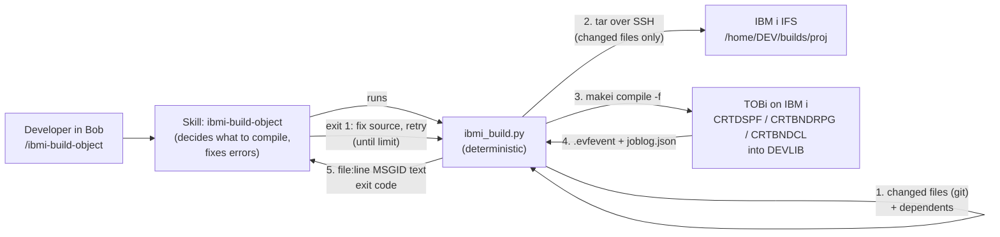

# IBM Bob + TOBi: automated IBM i build-and-fix loop

`/ibmi-build-object` is an IBM Bob slash command, backed by a Bob skill. It compiles RPGLE, SQLRPGLE, CLLE and DDS display-file source on your IBM i with **[TOBi (The Object Builder for i)](https://ibm.github.io/ibmi-tobi/#/)**. When the compile fails, Bob reads the compiler errors, fixes the source and recompiles, **up to a pre-set number of attempts**. It can compile specific files, the files changed in a commit, a branch, staged changes or unstaged changes.

```text
/ibmi-build-object qrpglesrc/custinq.pgm.rpgle        # one file
/ibmi-build-object --changed                          # all uncommitted work
/ibmi-build-object --changed --commit HEAD            # files in the last commit
/ibmi-build-object --changed --staged                 # only staged changes
/ibmi-build-object --changed --base origin/main       # everything on this branch
```

---

## ⭐ Why this is step 1 of automating Bob in your shop

Before Bob can safely take on bigger IBM i work (modernizing RPG, refactoring, writing new programs, reviewing pull requests), it needs a **trustworthy way to know whether its changes actually compile on your system.** This repo gives it one:

| What it gives you | Why it matters |
|---|---|
| **Ground truth from your IBM i.** A real TOBi compile against your libraries, not the AI's guess. | Every later automation (refactors, code generation, PR checks) can use "it compiles on our box" as its pass/fail signal. |
| **A bounded, auditable loop.** A script enforces the attempt limit, and every fix is logged. | Bob can't loop forever, hide errors, or "fix" by deleting code. Reviewers see exactly what changed. |
| **Low risk.** Builds go into a per-developer library, and fixes stay uncommitted. | Nothing touches production, and nothing is committed without a human. |
| **Deterministic plumbing.** Sync, compile, error parsing and change detection are plain Python. | The AI only does the judgement part, so results are repeatable and easy to debug. |

**Suggested roadmap once this works:**

1. **This repo:** a developer runs `/ibmi-build-object` in Bob IDE or Bob Shell.
2. **Gate pushes:** install the optional [pre-push hook](#optional-block-pushes-that-dont-compile). It compiles changed sources with zero AI fixes, so it's a pure check.
3. **CI:** run `ibmi_build.py changed --base origin/main --max-fix-attempts 0` in your pipeline against a CI library.
4. **Bigger Bob tasks:** for modernization or refactoring work, tell Bob to finish every task with `/ibmi-build-object --changed`, so "done" means "compiles on the IBM i".

---

## How it works



| Piece | File | Role |
|---|---|---|
| Slash command | `.bob/commands/ibmi-build-object.md` | Entry point. Parses your arguments and hands off to the skill. |
| Skill | `.bob/skills/ibmi-build-object/SKILL.md` | The build → read errors → fix → retry procedure, with the stop conditions. |
| Script | `.bob/skills/ibmi-build-object/scripts/ibmi_build.py` | Change detection, dependents, SSH sync, remote `makei`, error parsing, attempt limit. Standard library only. |
| Playbook | `.bob/skills/ibmi-build-object/reference/error-playbook.md` | Common RNF / CPD / DDS / SQL errors and safe fixes. |
| Rules | `.bob/rules/ibmi-build-guardrails.md` | Always-on guardrails: no config edits, no deleting logic, no commits, respect the limit. |
| Settings | `.bob/ibmi-build.conf` (from `.example`) | Host, user, IFS folder, object library, **`IBMI_MAX_FIX_ATTEMPTS`**. |
| Sample app | `qddssrc/`, `qrpglesrc/`, `qrpgleref/`, `qclsrc/` | DSPF + RPGLE + copybook + CLLE, wired together with `Rules.mk`. |
| Demo | `demo/break-build.patch` | Adds one RPG error and one CL error so you can watch the fix loop. |
| Tests | `tests/run_tests.sh` | Offline end-to-end tests against a fake IBM i. |

**Script exit codes**, which the skill branches on:

| Code | Meaning |
|---|---|
| 0 | Compiled |
| 1 | Compile errors. Bob may fix and retry. |
| 2 | Environment or configuration problem. Bob must not edit source. |
| 3 | Fix-attempt limit reached. Bob stops and reports. |
| 4 | Nothing to compile |

---

## Step-by-step setup

### Prerequisites

- IBM i 7.3 or later with **PASE (5770-SS1 option 33)** and an SSH server (5733-SC1 OpenSSH).
- A developer user profile on the IBM i.
- Your workstation: **IBM Bob** (IDE or Shell), **git**, **Python 3.8+**, and an **OpenSSH client** (built into macOS, Linux and Windows 10+).

### Part A: on the IBM i (one time per system, plus one time per developer)

Run these as a user with enough authority (typically the system admin). Replace `DEVUSER` / `DEVUSERLIB` with your names.

**A1. Start the SSH server, and make it start automatically**

```
STRTCPSVR SERVER(*SSHD)
CHGTCPSVR SVRSPCVAL(*SSHD) AUTOSTART(*YES)
```

**A2. Install the open-source package manager and TOBi**

Use **ACS → Tools → Open Source Package Management** (point and click), or from an SSH session:

```bash
/QOpenSys/pkgs/bin/yum install tobi
# TOBi pulls in its dependencies (bash, make-gnu, python3, python3-ibm_db, coreutils-gnu, ...)
# If your repository still has the older package name, install `bob` instead. The command is still `makei`.
```

Check the install:

```bash
/QOpenSys/pkgs/bin/makei -v
```

**A3. Give the developer a home folder, bash, an object library and a sensible CCSID**

```
MKDIR DIR('/home/DEVUSER')
CHGUSRPRF USRPRF(DEVUSER) HOMEDIR('/home/DEVUSER')
CRTLIB LIB(DEVUSERLIB) TEXT('DEVUSER build library (Bob/TOBi)')
```

If the profile's CCSID is 65535, set a real one, because compiles and IFS conversions misbehave under 65535:

```
CHGUSRPRF USRPRF(DEVUSER) CCSID(37)
```

Optional but recommended: make bash the PASE login shell. In Run SQL Scripts:

```sql
CALL QSYS2.SET_PASE_SHELL_INFO('DEVUSER', '/QOpenSys/pkgs/bin/bash');
```

(The script calls `/QOpenSys/pkgs/bin/bash` explicitly, so this mostly helps interactive SSH sessions.)

**A4. Set up SSH key login for the developer** (Bob runs non-interactively, so it can't type a password)

On the **workstation**:

```bash
ssh-keygen -t ed25519            # if you don't already have a key
ssh-copy-id DEVUSER@myibmi.example.com
```

Then on the **IBM i** (SSH in as DEVUSER), make sure the permissions are strict. OpenSSH ignores keys if the home folder is group- or world-writable:

```bash
chmod 755 ~ && chmod 700 ~/.ssh && chmod 600 ~/.ssh/authorized_keys
```

Test from the workstation. This must **not** ask for a password:

```bash
ssh -o BatchMode=yes DEVUSER@myibmi.example.com 'echo connected'
```

### Part B: on your workstation

**B1. Get the repo**

```bash
git clone <this-repo-url> ibmi-bob-tobi-build
cd ibmi-bob-tobi-build
```

**B2. Create your personal settings** (git-ignored)

```bash
cp .bob/ibmi-build.conf.example .bob/ibmi-build.conf
```

Edit `.bob/ibmi-build.conf`:

```ini
IBMI_HOST=myibmi.example.com
IBMI_USER=DEVUSER
IBMI_REMOTE_DIR=/home/DEVUSER/builds/ibmi-bob-tobi-build
IBMI_OBJLIB=DEVUSERLIB
IBMI_MAX_FIX_ATTEMPTS=3        # 1 initial compile + up to 3 fix-and-recompile cycles
```

**B3. Check the whole chain**

```bash
python3 .bob/skills/ibmi-build-object/scripts/ibmi_build.py check
```

Expected output:

```text
makei: found
remote dir: writable
objlib: exists
setccsid: found
Result       : ready
```

**B4. First manual compile** (proves that TOBi, the library list and CCSIDs work before AI is involved)

```bash
python3 .bob/skills/ibmi-build-object/scripts/ibmi_build.py compile \
  qddssrc/custdsp.dspf qrpglesrc/custinq.pgm.rpgle qclsrc/custmenu.pgm.clle --new-run
```

You should see three `[OK]` lines, and `CUSTDSP *FILE`, `CUSTINQ *PGM` and `CUSTMENU *PGM` in `DEVUSERLIB`. Try it on a 5250 session: `ADDLIBLE DEVUSERLIB` then `CALL CUSTMENU`. F3 exits.

> 🔎 **Check the error channel once:** SSH to the IBM i and run `ls /home/DEVUSER/builds/ibmi-bob-tobi-build/.bob-remote/logs/`. After a compile you should see `1.out`, `1.joblog.json` and a `1.evf/` folder. The `.evf` files are the compiler event files. They're what gives Bob exact `file:line` positions.

### Part C: in IBM Bob

**C1. Open the repo folder in Bob IDE** (or `cd` into it and start Bob Shell). Bob picks up these automatically:

- `.bob/commands/ibmi-build-object.md` → `/ibmi-build-object`
- `.bob/skills/ibmi-build-object/` → the skill
- `.bob/rules/ibmi-build-guardrails.md` → always-on rules

**C2. Use a mode that can use skills** (Bob's *Advanced* mode), and type `/` in the chat. You should see `ibmi-build-object` in the menu.

**C3. (Optional) Reduce approval prompts**

- Skill activation: add `"skill"` to `approval.allowed_permissions` in `~/.bob/settings/settings.json`.
- Command execution: in Bob's auto-approve settings, allow commands starting with `python3 .bob/skills/ibmi-build-object/scripts/ibmi_build.py`. Keep the allow-list narrow and leave other commands on "ask".

**C4. Try it**

```text
/ibmi-build-object qrpglesrc/custinq.pgm.rpgle
```

### Part D: watch the fix loop

```bash
git apply demo/break-build.patch      # adds a typo'd RPG field and a typo'd CL keyword
```

Then in Bob:

```text
/ibmi-build-object --changed
```

What happens:

1. The initial compile fails with:
   ```text
   [FAILED] qrpglesrc/custinq.pgm.rpgle -> CUSTINQ.PGM  (rc=2, 1 error(s))
       qrpglesrc/custinq.pgm.rpgle:44:7 RNF7030 sev30 The name or indicator CUSTNAM is not defined.
   [FAILED] qclsrc/custmenu.pgm.clle -> CUSTMENU.PGM  (rc=2, 1 error(s))
       qclsrc/custmenu.pgm.clle:19:27 CPD0043 sev30 Keyword MSGTYP not valid for this command.
   Fix attempts remaining: 3 of 3
   ```
2. Bob opens both files, changes `CUSTNAM` to `CUSTNAME` and `MSGTYP` to `MSGTYPE`, and logs both fixes in `.bob/build/fix-log.md`.
3. Bob recompiles **only the two failed sources**, and they succeed.
4. Bob reports the objects built, attempts used, each fix, and a reminder to review with `git diff`.

Undo the demo with `git checkout -- qrpglesrc qclsrc`.

---

## Compiling changed source (commits, staged, unstaged)

The script works out the file list from git, keeps compilable types (`IBMI_SOURCE_EXTS`), and **adds dependents**:

- **Display files / printer files / PF / LF:** every `Rules.mk` target that lists the changed `*.FILE` as a prerequisite is recompiled too, which prevents level checks at run time. For example, changing `custdsp.dspf` also recompiles `custinq.pgm.rpgle`.
- **Copybooks** (`IBMI_INCLUDE_EXTS`, default `.rpgleinc`): every RPG source whose `/COPY` or `/INCLUDE` references the copybook is recompiled.

| Option | Files considered |
|---|---|
| *(default)* / `--working` | staged + unstaged + untracked |
| `--staged` | staged only (handy right before `git commit`) |
| `--unstaged` | unstaged + untracked |
| `--commit <sha>` | files changed in that commit (`HEAD` = last commit) |
| `--range A..B` | files changed between two refs |
| `--base <ref>` | files changed on this branch since `<ref>`, plus uncommitted work |

Preview without compiling:

```bash
python3 .bob/skills/ibmi-build-object/scripts/ibmi_build.py changed --commit HEAD --dry-run
```

> For `--commit` of an older commit, the *list* of files comes from that commit, but the *content* compiled is your current working tree, because that's where Bob makes fixes. The script prints a note when the commit isn't `HEAD`.

---

## The attempt limit

- `IBMI_MAX_FIX_ATTEMPTS=3` (in the config, or `--max-fix-attempts N` on the command) allows **1 initial compile + 3 fix-and-recompile cycles**.
- The limit is enforced **by the script**, not just by instructions to the AI. The counter lives in `.bob/build/state.json`. After the last allowed compile the script returns exit 3, and it refuses further compiles until someone starts a new run (`--new-run`).
- A run resets automatically after a fully successful build, or after 12 hours.
- `ibmi_build.py status` shows attempts used, and `ibmi_build.py reset` clears the counter.

---

## Using this in your own repository

1. Copy `.bob/commands/`, `.bob/skills/ibmi-build-object/`, `.bob/rules/` and `.bob/ibmi-build.conf.example` into your repo. Alternatively, put the skill and command in `~/.bob/skills/` and `~/.bob/commands/` to use them across all projects.
2. Add the `.gitignore` lines from this repo (`.bob/ibmi-build.conf`, `.bob/build/`, `.logs/`, `.evfevent/`, `.bob-remote/`).
3. Make sure your project is a TOBi project:
   - `iproj.json` with `"objlib": "&OBJLIB"` (the script exports `OBJLIB` from `IBMI_OBJLIB`)
   - a root `Rules.mk` with `SUBDIRS = ...`, and a `Rules.mk` per source folder
   - TOBi naming (`name.pgm.rpgle`, `name.pgm.clle`, `name.dspf`, and so on). See `reference/tobi-conventions.md`.
   - For a large existing code base, **Source Orbit** (in Code for IBM i) can generate the `Rules.mk` files for you.
4. Run `check`, then do one manual `compile` (Part B), then hand it to Bob.

---

## Optional: block pushes that don't compile

```bash
cp scripts/git-hooks/pre-push .git/hooks/pre-push && chmod +x .git/hooks/pre-push
```

The hook compiles everything changed since the upstream branch with `--max-fix-attempts 0` (no AI, pure check). It blocks the push on compile errors, and allows it if the IBM i is unreachable. Skip once with `git push --no-verify`.

---

## Configuration reference

| Setting | Default | Meaning |
|---|---|---|
| `IBMI_HOST`, `IBMI_USER` | — | SSH target (key-based login) |
| `IBMI_SSH_PORT`, `IBMI_SSH_KEY` | — | Optional SSH port / identity file |
| `IBMI_SSH_OPTS` | `-o BatchMode=yes -o ConnectTimeout=20` | Never hang on a password prompt |
| `IBMI_REMOTE_DIR` | — | IFS build folder (one per developer per project) |
| `IBMI_OBJLIB` | — | Library for compiled objects (`&OBJLIB` in `iproj.json`) |
| `IBMI_MAX_FIX_ATTEMPTS` | `3` | Fix-and-recompile cycles allowed after the first compile |
| `IBMI_SETCCSID` | `1208` | CCSID tag for synced files (blank = skip) |
| `IBMI_MAKEI` | `/QOpenSys/pkgs/bin/makei` | TOBi CLI path |
| `IBMI_REMOTE_SHELL` | `/QOpenSys/pkgs/bin/bash` | Shell used for the remote build script |
| `IBMI_SOURCE_EXTS` | `.rpgle,.sqlrpgle,.clle,.dspf` | Compilable types (add `.prtf`, `.sqlrpgle`, `.rpgle` modules, and so on) |
| `IBMI_INCLUDE_EXTS` | `.rpgleinc,.sqlrpgleinc` | Copybook types (trigger dependent recompiles) |
| `IBMI_FILE_OBJECT_EXTS` | `.dspf,.prtf,.pf,.lf` | Types that create `*FILE` objects (trigger dependent recompiles) |
| `IBMI_ERROR_SEVERITY` / `IBMI_WARNING_SEVERITY` | `20` / `10` | Message severity thresholds |

Every setting can be overridden with an environment variable of the same name, which is useful in CI.

**Outputs** (all under `.bob/build/`, git-ignored): `last-build.md`, `last-build.json`, `state.json`, `fix-log.md`, `remote/` (raw logs and event files), `sync-manifest.json`.

---

## Troubleshooting

| Symptom | Fix |
|---|---|
| `ENVIRONMENT ERROR: SSH connection ... failed` | Run `ssh -o BatchMode=yes USER@HOST echo ok`. Fix key login (Part A4) and permissions on `~` and `~/.ssh` on the IBM i. |
| `makei not found` | `yum install tobi`, or set `IBMI_MAKEI` to the right path. |
| `objlib: NOT FOUND` | `CRTLIB DEVUSERLIB`. |
| Compile fails but the report shows no `file:line` errors | The script falls back to job-log messages and the `makei` output tail. Look in `.bob/build/remote/.bob-remote/logs/`. If `N.evf/` is always missing, check that your TOBi version writes `.evfevent` files (current versions do, for Code for IBM i's error list). |
| Garbled characters / CCSID errors | Set the user profile `CCSID(37)` (or your national CCSID), keep `IBMI_SETCCSID=1208`, and consider a `.ibmi.json` with `tgtCcsid` in source folders. |
| `X is not referenced by any Rules.mk` | Add a rule for it (see `reference/tobi-conventions.md`). Without one, TOBi doesn't know which object to build. |
| SQLRPGLE line numbers look off | They refer to the precompiler's generated source. The report flags these, and the skill matches on statement text. |
| Files deleted locally still exist on the IBM i | The sync only adds or updates files. Run `--full-sync` after big reorganisations, or clean the IFS folder. |
| Slow first sync | Later syncs send only changed files. To reuse SSH connections, add `ControlMaster auto` / `ControlPersist 10m` for the host in `~/.ssh/config`. |
| Windows: `python3` not found | Use `python`, or edit the command paths in `SKILL.md`. Git for Windows' bash works for the tests and hook. |

---

## Testing the tooling without an IBM i

```bash
bash tests/run_tests.sh
```

This runs the full loop (sync, compile, error parsing, dependents, commit and staged detection, attempt limit, environment errors) against `tests/fake-ibmi/`, a fake `ssh` and `makei` that simulate the two demo errors.

---

## License

Sample code. Add the license your organization prefers before you publish it. TOBi itself is Apache-2.0.
